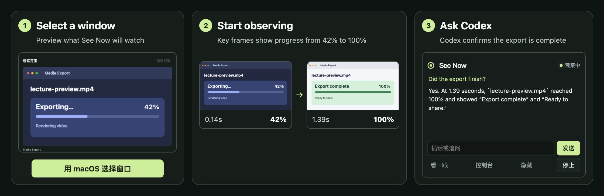

# Codex See Now

[简体中文](README.md) · **English**

Let Codex watch what happens on your screen. Select a window or crop an area, and See Now selects key frames on your device. Codex can report changes in a floating window, where you can ask follow-up questions at any time.

[Standalone desktop client](#standalone-desktop-client) · [Codex MCP plugin](#codex-mcp-plugin)



*The demo uses a simulated export window. See Now keeps frames from before and after the change so Codex can answer whether the export finished.*

## Standalone desktop client

Use the app for ongoing observation, automatic updates, and follow-up questions in a floating window. It requires Node.js 22+ and the Codex CLI on your `PATH`. The app has been tested on macOS.

### Quick start

```sh
git clone https://github.com/Berlin070777/codex-see-now.git
cd codex-see-now
npm ci
npm start
```

1. **Connect Codex.** In **账号** (Account), choose ChatGPT, local Codex, or an OpenAI API key. To reuse a local login, run `codex login` if needed and choose **使用本机 Codex** (Use local Codex).
2. **Choose what to watch.** On macOS 15 or later, click **用 macOS 选择窗口** (Choose a window with macOS). Drag on the preview to crop. You can also load the screen and window list, choose a camera or OBS virtual camera, or open a local video. If the list needs permission, grant it in **System Settings → Privacy & Security → Screen & System Audio Recording** and reopen See Now.
3. **Start observing.** Click **开始观察** (Start observing). With automatic analysis on, screen changes trigger replies. Ask a follow-up in the floating window or click **看一眼** (Take a look) to request an update. Click **停止** (Stop) to end capture.

### Accounts and models

| Connection | How it works |
| --- | --- |
| Continue with ChatGPT | Authorize eligible ChatGPT plan usage in the system browser. See Now uses its own OAuth registration and a local Codex App Server. |
| Local Codex | Reuses the local Codex CLI credentials for development and personal use. |
| OpenAI API key | Uses your own Platform API key and API billing. |

Model availability depends on the selected connection and account permissions. Refresh the list or enter a custom model ID. You can switch models while observing. The new model applies to the next reply. The desktop app reuses a temporary chat for updates and follow-up questions within an observation. These chats stay out of the Codex chat list. Stopping or reconnecting starts a fresh context for the next analysis. Authorization, refresh, and API credentials are handled in the main process, with credentials encrypted using the operating system credential store. See the [OpenAI integration guide](https://developers.openai.com/siwc/token-sharing-open-source/codex-app-server) for ChatGPT plan authorization.

## Features and compatibility

| Feature | Standalone desktop client |
| --- | --- |
| Sources | Displays, windows, interactive region selection, cameras, OBS virtual cameras, and video files supported by Chromium. |
| Frame selection | Reference frame, change-based selection, chronological contact sheets, single-frame scene mode, four quality settings, four paces, and capture statistics. |
| Automatic observation | Combines new frames while a reply runs and sends the next batch when Codex is available. Automatic analysis can be turned off for manual use. |
| Floating companion | Streams replies and transcripts. Ask a follow-up, take a look, hide the window, or stop. Submission pauses when the companion covers the selected screen area and resumes when it is hidden. |
| Speech and audio | Optional read-aloud replies. System audio, file audio, or microphone input can be sent to an OpenAI-compatible transcription service you configure. Sheets can show audio levels and transcripts include timestamps. |
| Platforms | Uses Electron’s cross-platform capture interfaces. macOS is the current verification platform. Windows and Linux device selection, permissions, and system audio still need testing on those systems. |

The menu bar, observation controls, and companion window take the place of DSH’s `/seenow` command. DeepSeek image token tiers, DSH attachment history, and DSH’s transcription integration belong to their respective hosts. The MCP plugin returns its results to the current Codex chat.

## Audio transcription

Open **音频转写** (Audio transcription) and choose an audio source, endpoint, and model. The service must expose an OpenAI-compatible `/audio/transcriptions` endpoint and accept WebM/Opus audio. Use HTTPS or a local HTTP endpoint such as `http://127.0.0.1:8000/v1`. Supply a separate transcription API key if required. The selected service receives the audio clips.

## Codex MCP plugin

Install the MCP plugin to watch a short stretch of screen activity inside an official Codex chat. The plugin supports macOS and requires Node.js 20.3+ and FFmpeg with AVFoundation input.

```sh
brew install node ffmpeg
codex plugin marketplace add Berlin070777/codex-see-now
codex plugin add codex-see-now@see-now-plugins
```

Restart Codex and start a local chat. Try “Use See Now to watch the top-left quarter of my display for 10 seconds and tell me what happens.” Run `vision_test` to check whether Codex can read a random code from a synthetic image.

| Tool | Purpose |
| --- | --- |
| `watch_screen` | Observe for 2–30 seconds and return contact sheets when capture ends. |
| `start_watch` / `next_frames` / `stop_watch` | Start a 5–120 second observation, read sheets by session ID, and stop. |
| `vision_test` | Return a synthetic code image without accessing the screen. |

Uninstall with `codex plugin remove codex-see-now@see-now-plugins`. Remove the marketplace too with `codex plugin marketplace remove see-now-plugins`.

## Data handling and limitations

- Capture, cropping, and frame selection happen locally. Analysis sends selected frames and relevant transcripts to the selected Codex conversation. Your optional transcription service receives the audio.
- Capture sees visible pixels from the selected source. Occluded content, very brief events, and subtle changes can be missed. Crop more tightly or increase quality to read small text.
- The desktop client buffers up to four recent sheets while busy. Stopping clears queued observations.
- ChatGPT authorization and model access depend on the account, plan, and workspace settings. The desktop client starts in local Codex mode and can be switched to another connection.

## Development, packaging, and contributions

```sh
npm test
npm run package:mac
```

The macOS packaging command builds an app directory for local testing. It does not provide distribution signing or notarization. The [desktop client](desktop/) and [MCP plugin](plugins/codex-see-now/) share the upstream frame pipeline. [Issues](https://github.com/Berlin070777/codex-see-now/issues) and pull requests are welcome. For bugs, include the platform, Codex version, capture source, and reproduction steps.

## License and credits

New code is licensed under [MIT](LICENSE). The upstream project [SAOS-3624/dsh-see-now](https://github.com/SAOS-3624/dsh-see-now) was created by [SAOS-3624](https://github.com/SAOS-3624). Reused code and its modifications retain the [Apache 2.0 license](plugins/codex-see-now/vendor/dsh-see-now/LICENSE) and [original NOTICE](plugins/codex-see-now/vendor/dsh-see-now/NOTICE). See the [upstream revision and local changes](plugins/codex-see-now/vendor/dsh-see-now/README.md).
