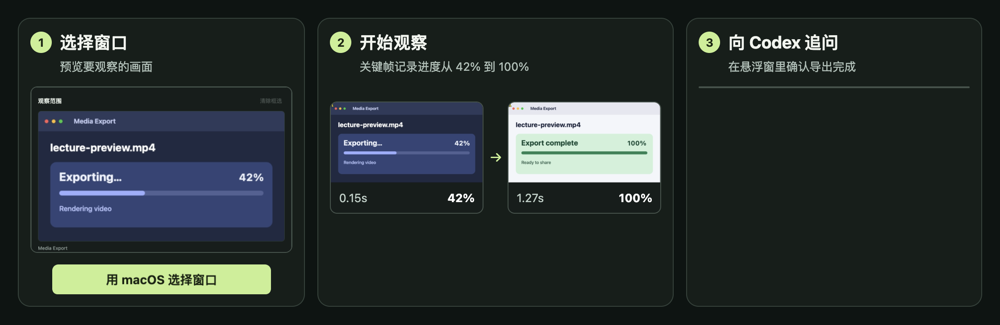

# Codex See Now

**简体中文** · [English](README.en.md)

让 Codex 看着你操作屏幕。选一个窗口或框出一块区域，See Now 会在本机筛出关键帧。画面有变化时，Codex 可以在悬浮窗里主动汇报，你也可以随时追问。

[独立桌面客户端](#独立桌面客户端) · [Codex MCP 插件](#codex-mcp-插件)



*演示使用模拟的导出窗口。See Now 保留进度变化前后的画面，Codex 据此回答「导出完成了吗？」。*

## 独立桌面客户端

适合持续观察、自动汇报和悬浮窗追问。运行需要 Node.js 22+ 和可从 `PATH` 找到的 Codex CLI。目前已在 macOS 验证。

### 快速开始

```sh
git clone https://github.com/Berlin070777/codex-see-now.git
cd codex-see-now
npm ci
npm start
```

1. **连接 Codex。** 在「账号」里选择 ChatGPT、本机 Codex 或 OpenAI API Key。若要复用本机登录，可先运行 `codex login`，再点 **使用本机 Codex**。
2. **选择画面。** 在 macOS 15 及以上，点击 **用 macOS 选择窗口**，选中窗口后可在预览上拖动框选。还可加载屏幕和窗口列表，或使用摄像头、OBS 虚拟摄像头、本地视频。若列表提示缺少录屏权限，在「系统设置 → 隐私与安全性 → 屏幕与系统音频录制」授权后重启 See Now。
3. **开始观察。** 点击 **开始观察**。开启「变化时自动分析」后，画面变化会触发回复。也可以在悬浮窗追问，或点击 **看一眼** 手动观察。点击 **停止** 结束采集。

### 账号与模型

| 连接方式 | 使用方式 |
| --- | --- |
| Continue with ChatGPT | 在系统浏览器授权使用符合条件的 ChatGPT 套餐。See Now 用自己的 OAuth 注册和本机 Codex App Server。 |
| 本机 Codex | 使用 Codex CLI 已保存的认证，适合本机开发和自用。 |
| OpenAI API Key | 填写自己的 Platform API Key，按 API 用量计费。 |

模型列表跟随当前连接方式和账号权限。可以刷新列表或手动输入模型 ID。观察中也可切换模型，下一轮回复使用新模型。桌面端在同一次观察中复用临时会话，汇报和追问不会占用 Codex 对话列表。停止观察或重连后，模型会从新的临时会话开始。登录授权、续期和 API Key 在主进程处理，凭据通过操作系统凭据存储加密。ChatGPT 套餐授权详情见 [OpenAI 接入文档](https://developers.openai.com/siwc/token-sharing-open-source/codex-app-server)。

## 功能与兼容性

| 功能 | 独立桌面端 |
| --- | --- |
| 采集来源 | 屏幕、窗口、交互式区域框选、摄像头、OBS 虚拟摄像头、Chromium 支持的视频文件。 |
| 筛帧与出图 | 保留参考帧、按变化筛帧、时间拼图、逐场景单张、四档画质、四档节奏、采集统计。 |
| 主动观察 | 照顾正在运行的回复，合并新帧，闲时再提交。可关闭自动分析，仅在手动提问时读图。 |
| 悬浮窗 | 显示流式回复和转写，支持追问、看一眼、隐藏、停止。悬浮窗盖住所选屏幕区域时暂停提交，隐藏后恢复。 |
| 语音与音频 | 可朗读回复。可选系统音频、视频音轨或麦克风，使用用户设置的 OpenAI 兼容转写服务。拼图可附响度条，转写会附时间。 |
| 平台 | 桌面代码使用 Electron 的跨平台媒体接口。macOS 是当前验证平台。Windows 和 Linux 的设备、权限及系统音频仍需真机验证。 |

原版的 DSH `/seenow` 命令由菜单栏、开始/停止和悬浮窗控制替代。DeepSeek 的图像 token 档位、DSH 的历史附件管理和转写服务由对应宿主决定。MCP 插件直接把观察结果交给当前 Codex 对话。

## 音频转写

打开 **音频转写**，选择音频来源、服务地址和模型。服务须提供 OpenAI 兼容的 `/audio/transcriptions`，并接受 WebM/Opus 音频。地址可以是 HTTPS 服务，也可以是本机 HTTP，例如 `http://127.0.0.1:8000/v1`。如果服务需要密钥，填入转写专用 API Key。此设置与 Codex 登录分开。所选服务会收到实际音频片段。

## Codex MCP 插件

想在官方 Codex 聊天里临时观察几秒屏幕，可以直接安装 MCP 插件。插件支持 macOS，需要 Node.js 20.3+ 和带 AVFoundation 的 FFmpeg。

```sh
brew install node ffmpeg
codex plugin marketplace add Berlin070777/codex-see-now
codex plugin add codex-see-now@see-now-plugins
```

重启 Codex 并开一个本地新聊天。可以说「用 See Now 看主显示器左上四分之一，接下来 10 秒告诉我发生了什么」。用 `vision_test` 可以验证 Codex 能否读到合成图里的随机数字。

| 工具 | 用途 |
| --- | --- |
| `watch_screen` | 观察 2–30 秒，结束后返回拼图。 |
| `start_watch` / `next_frames` / `stop_watch` | 观察 5–120 秒，按会话 ID 分批取图并停止。 |
| `vision_test` | 返回含随机数字的测试图，无需录屏权限。 |

卸载插件时运行 `codex plugin remove codex-see-now@see-now-plugins`。如需移除来源，再运行 `codex plugin marketplace remove see-now-plugins`。

## 数据和限制

- 采集、裁剪和筛帧在本机完成。发起分析时，选中的关键帧和相关转写会进入所选 Codex 会话；可选转写服务会收到音频。
- 只分析采集源可见的像素。短于采样间隔、被遮挡或变化幅度很小的内容可能漏掉。小字难辨时缩小区域或提高画质。
- 忙时最多保留最近四张待发送拼图。停止后不会继续发送排队的画面。
- ChatGPT 授权和所选模型的可用性受账号、套餐及工作区设置影响。桌面客户端默认使用当前本机 Codex 登录，亦可主动切换。

## 开发、打包与贡献

```sh
npm test
npm run package:mac
```

`npm run package:mac` 生成本机可测试的应用目录，默认不提供正式发布签名或公证。[桌面客户端](desktop/)与 [MCP 插件](plugins/codex-see-now/)共享同一套上游筛帧代码。欢迎向 [GitHub Issues](https://github.com/Berlin070777/codex-see-now/issues) 提交问题或 Pull Request。反馈请附平台、Codex 版本、采集来源和复现步骤。

## 许可证和致谢

新增代码采用 [MIT](LICENSE)。原项目 [SAOS-3624/dsh-see-now](https://github.com/SAOS-3624/dsh-see-now) 由 [SAOS-3624](https://github.com/SAOS-3624) 开发。复用代码及其修改保留 [Apache 2.0](plugins/codex-see-now/vendor/dsh-see-now/LICENSE) 和[原始 NOTICE](plugins/codex-see-now/vendor/dsh-see-now/NOTICE)。[上游版本与修改记录](plugins/codex-see-now/vendor/dsh-see-now/README.md)。
