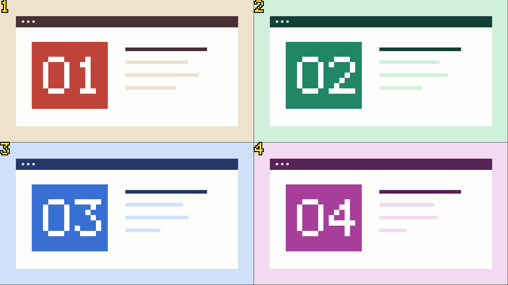

# Codex See Now

**简体中文** · [English](README.en.md)

让 macOS 上的 Codex 看见你接下来几秒的屏幕操作。演示一个界面问题、切换几个页面，或者走一遍工作流时，Codex 可以根据按时间排列的关键帧描述发生了什么。

插件基于 [dsh-see-now](https://github.com/SAOS-3624/dsh-see-now)。FFmpeg 在本机采集屏幕，插件按画面变化选帧，将它们拼成带编号的 PNG，再通过本地 MCP 交给 Codex。静止画面保留一张参考帧，后续没有明显变化时不会反复发图。



*由筛帧和拼图代码生成的合成示例。四格分别对应 0、2、4、6 秒，工具会在图片旁返回每格时间。*

## 快速开始

**环境要求：** macOS、Node.js 20.3 或更高版本、带 AVFoundation 输入的 FFmpeg，以及支持本地插件的 Codex。已在 Apple Silicon Mac 上验证本地采集和 Codex CLI 读图。

使用 Homebrew 的话，可以这样安装依赖：

```sh
brew install node ffmpeg
```

添加 GitHub 仓库提供的插件来源，再安装插件：

```sh
codex plugin marketplace add Berlin070777/codex-see-now
codex plugin add codex-see-now@see-now-plugins
```

也可以先克隆仓库，从仓库根目录运行 `codex plugin marketplace add "$PWD"`，再运行同一个 `codex plugin add`。添加来源后，也可以在桌面端的插件目录里从 **See Now Plugins** 安装 **See Now**。

如果桌面端已经打开，重启后开一个本地新聊天。首次抓屏时，在 macOS 的「系统设置 → 隐私与安全性 → 屏幕与系统音频录制」允许启动采集的应用，然后按系统提示重启该应用。只跑合成图测试无需录屏权限。

## 使用方式

- **观察一小段操作**：「用 See Now 看主显示器左上四分之一。接下来 10 秒我会切三个页面，按顺序告诉我发生了什么。」
- **分批看变化**：「用 See Now 看主显示器右半边 30 秒，分批读图。我说停就停止采集。」
- **验证 Codex 能读图**：「调用 See Now 的 `vision_test`，只读出图片里的六位数字。」
- **停止观察**：「停止 See Now。」分批模式会停止采集并丢弃未读取的拼图。正在执行的观察也可通过取消工具调用或结束客户端会话来终止。

显示器从 `0` 开始编号。区域用所选显示器宽高的整数百分比，从左上角起算。例如，左上四分之一是 `{"x":0,"y":0,"width":50,"height":50}`。需要整块显示器时，在提示词中明确指定。

| MCP 工具 | 用途 |
| --- | --- |
| `watch_screen` | 观察 2–30 秒，默认 10 秒，结束后返回关键帧拼图。 |
| `start_watch` | 开始 5–120 秒的分批观察，默认 30 秒，返回会话 ID。 |
| `next_frames` | 按会话 ID 取下一张拼图，单次最多等待 10 秒。 |
| `stop_watch` | 停止指定的分批观察，丢弃未读取的帧。 |
| `vision_test` | 生成只含随机六位数字的测试图，不读取屏幕。 |

## 与上游项目的功能对照

当前版本支持 macOS 屏幕观察。下表列出的可移植项是技术判断，尚未交付。

| 上游能力 | Codex See Now 当前状态 | 进一步移植的条件 |
| --- | --- | --- |
| macOS 屏幕采集、按变化筛帧、关键帧拼图 | 已支持。短时观察或分批取图。 | — |
| 指定区域、交互式框选 | 已支持百分比区域和整屏选择。 | 鼠标框选需要桌面界面。 |
| 摄像头、OBS 虚拟摄像头、视频文件回放 | 未实现。 | 可以复用采集代码，为不同来源增加选择、权限和测试。 |
| Windows、Linux 屏幕采集 | 未实现。 | 可参考上游的 Windows 抓屏和 Linux Portal/PipeWire 实现，逐平台验证。 |
| 逐场景出图、节奏和清晰度档位、调试窗 | 未实现。 | 可以复用上游的参数和算法；调试窗需要单独接入。 |
| 悬浮窗、字幕式回复、语音播报 | 未实现。 | 可做独立桌面辅助程序，接入本地 TTS。 |
| 系统音频、转写和画面对齐 | 未实现。 | 需要各平台的音频采集和转写适配。上游现有回环采集主要针对 Windows。 |
| `/seenow`、悬浮窗插话、按画面变化唤醒原会话 | 未实现。分批模式由 Codex 在当前任务中调用工具取图。 | 这些功能依赖 DSH 的命令、附件和会话接口。可评估基于 [Codex App Server](https://learn.chatgpt.com/docs/app-server) 的独立客户端。对官方桌面聊天的直接接管没有经过验证。 |
| DeepSeek 图像 token 档位、DSH 附件和历史省略 | 不沿用上游的计费和历史处理规则。 | 可以控制出图尺寸和频率；图片计量和会话历史由 Codex 决定。 |

## 数据和限制

- FFmpeg 在本机采集并裁剪，插件在内存里筛帧和拼图。插件不写截图文件，不内置遥测或额外的上传服务。返回的图片会进入 Codex 会话，并按 Codex 的设置处理。
- 只观察所选屏幕上的可见像素。被遮挡的窗口、很快闪过的内容或细微变化可能看不到。小字难辨时，可以缩小采集区域。
- 分批模式最多缓存四张待取拼图。读取慢于出图时会丢弃最早的拼图。当前没有按画面变化自动开启新聊天轮次的功能。
- 当前验证覆盖 macOS 真实抓屏和 Codex CLI 的图像回传。桌面聊天内的首次录屏仍需实际确认权限与可见画面。

## 排查问题

| 现象 | 处理方法 |
| --- | --- |
| Codex 找不到工具 | 运行 `codex plugin list` 确认插件已安装并启用。重启桌面端，再开本地新聊天。 |
| 找不到 FFmpeg 或采集失败 | 运行 `ffmpeg -hide_banner -devices`，确认列表含 `avfoundation`。检查显示器编号。 |
| 没有可见画面 | 解锁 Mac，检查录屏权限，并确认所选区域有可见内容。先用 `vision_test` 验证 Codex 能否读取工具图片。 |
| 分批观察暂时没有新图 | 没有明显变化时属正常现象。可以在所选区域切换页面，再读下一批。 |

## 卸载

```sh
codex plugin remove codex-see-now@see-now-plugins
codex plugin marketplace remove see-now-plugins
```

## 开发和贡献

在仓库根目录运行测试，无需安装 npm 依赖。FFmpeg 可用时，测试也会检查真实的裁剪滤镜输出。

```sh
node --test
```

[插件目录](plugins/codex-see-now/)包含 Codex 清单、本地 MCP 服务和采集逻辑。[测试目录](test/)覆盖工具输出、静止去重、时间顺序、停止、取消和裁剪行为。

项目由 [Berlin070777](https://github.com/Berlin070777) 维护。欢迎提交 [Issue](https://github.com/Berlin070777/codex-see-now/issues) 或 Pull Request。报告采集问题时，请附上 macOS、Codex、Node.js 和 FFmpeg 版本、复现步骤与错误文本。

## 许可证和致谢

新增代码采用 [MIT](LICENSE)。复用的 [SAOS-3624/dsh-see-now](https://github.com/SAOS-3624/dsh-see-now) 源码及其修改保留 [Apache 2.0](plugins/codex-see-now/vendor/dsh-see-now/LICENSE) 和[原始 NOTICE](plugins/codex-see-now/vendor/dsh-see-now/NOTICE)。[上游来源和修改记录](plugins/codex-see-now/vendor/dsh-see-now/README.md)。
